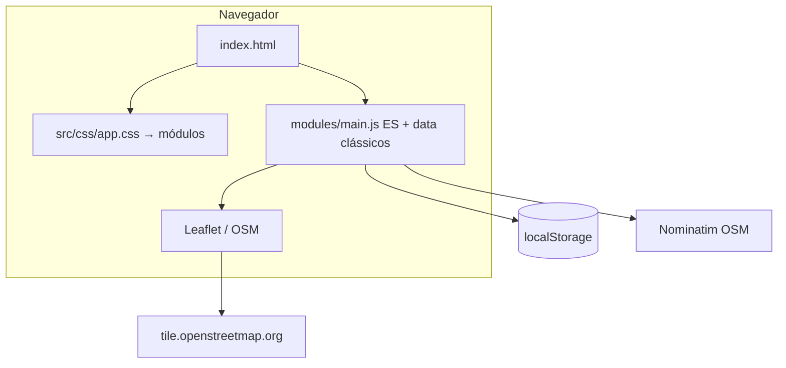
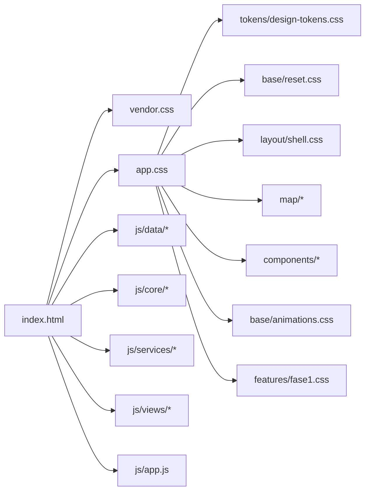
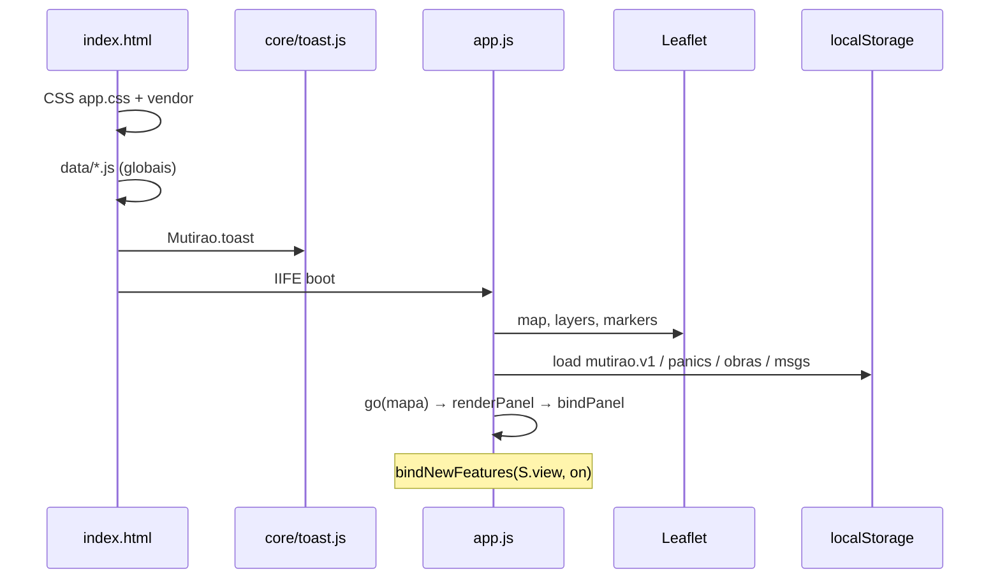
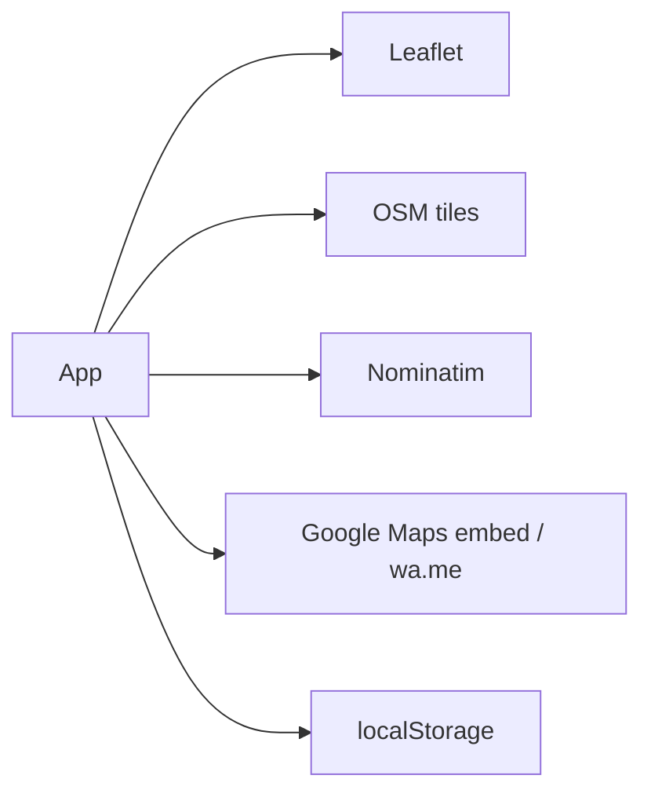
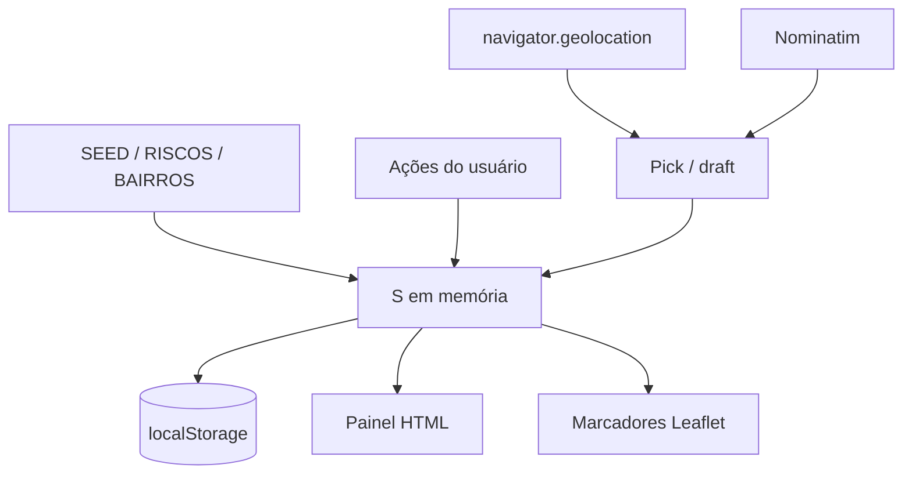
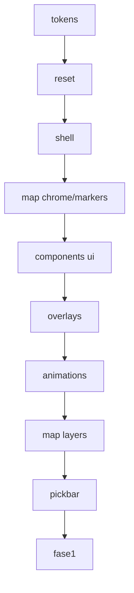
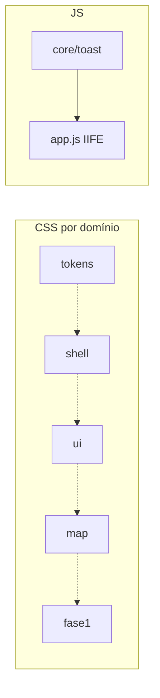
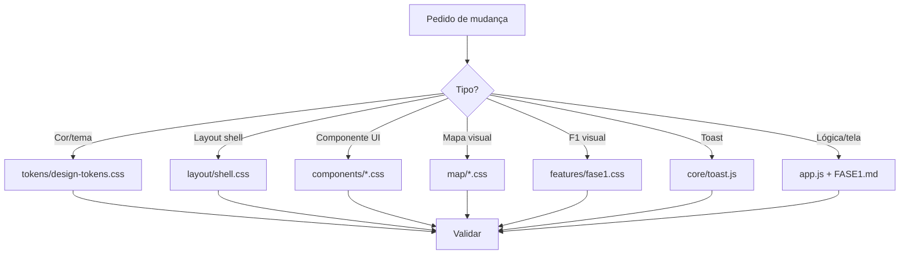
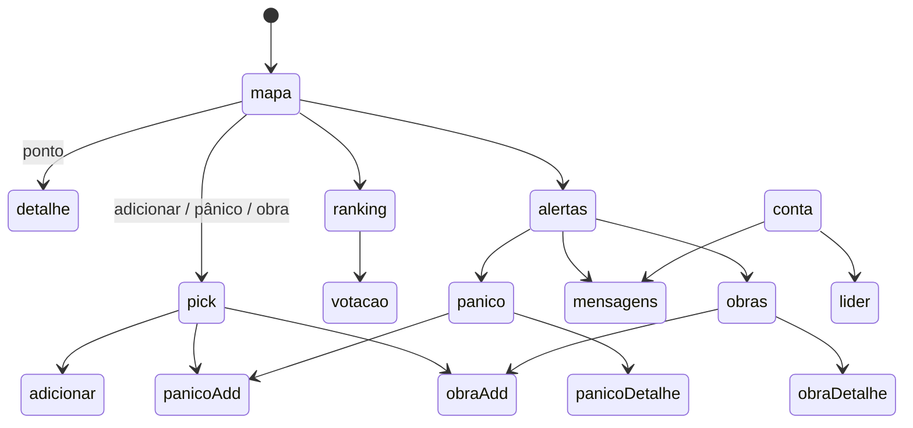

> Documento alinhado ao código **1.11.2** (novembro/2026). Detalhes de produto: `DOCUMENTATION/DEVELOPMENT/CHANGELOG.md`.

# Documentação de Infraestrutura — Mutirão · Recife

**Versão da doc:** 2026-11-12  
**Tipo de app:** protótipo web estático (vanilla HTML/CSS/JS)  
**Objetivo deste documento:** permitir que um desenvolvedor ou uma IA localize, altere e valide qualquer parte do sistema **sem reler a base inteira**.

Documentos complementares:

| Arquivo | Uso |
|---|---|
| [`DOCUMENTATION/AI_CONTEXT_GUIDE.md`](DOCUMENTATION/AI_CONTEXT_GUIDE.md) | Regras operacionais para IAs |
| [`DOCUMENTATION/FASE1.md`](DOCUMENTATION/FASE1.md) | Pânico, obras, líder |
| [`DOCUMENTATION/DESIGN_SYSTEM.md`](DOCUMENTATION/DESIGN_SYSTEM.md) | Tokens e identidade visual |
| [`DOCUMENTATION/AI_GUIDELINES.md`](DOCUMENTATION/AI_GUIDELINES.md) | Como a IA deve navegar o repo |
| [`DOCUMENTATION/CHANGELOG_REESTRUTURACAO.md`](DOCUMENTATION/CHANGELOG_REESTRUTURACAO.md) | O que mudou nesta reestruturação |
| [`src/js/STRUCTURE.md`](src/js/STRUCTURE.md) | Árvore e ordem de scripts JS |

---

## 1. Visão geral

### Objetivo do sistema

Mapa colaborativo de problemas urbanos em Recife (barreiras, alagamentos, buracos, etc.). A associação de bairro usa os registros para cobrar o poder público. Ninguém cobra sozinho.

### Funcionalidades principais

| Área | Descrição |
|---|---|
| Mapa | Leaflet + OSM, world mask RMR, pontos, clusters |
| Problemas | Criar, apoiar, notar, foto, Street View, WhatsApp |
| Ranking / votação | Priorização mensal por região |
| Conta | Login local (protótipo), perfil |
| Fase 1 | Pânico, obras públicas, mensagens ao líder |
| Tema | Claro / escuro |

### Tecnologias

- **HTML5** estático (`index.html`)
- **CSS3** modular + custom properties (design tokens)
- **JavaScript** vanilla (IIFE em `app.js` + namespace `window.Mutirao`)
- **Leaflet 1.9.4** + MarkerCluster 1.5.3 (CDN)
- **Nominatim OSM** (geocode, sem API key)
- **localStorage** (sem backend)
- **Vercel** (static + `scripts/inject-env.mjs`)

### Arquitetura em uma frase

Shell HTML carrega CSS modular e scripts em ordem fixa; `app.js` concentra mapa, estado e views; `Mutirao.toast` e tokens CSS são os únicos pontos canônicos de notificação e identidade visual.



---

## 2. Estrutura de diretórios

```
mutirao/
├── index.html                          # Único HTML — ponto de entrada
├── DOCUMENTACAO_INFRAESTRUTURA.md       # Este arquivo
├── README.md
├── package.json
├── vercel.json
├── .env.example
├── scripts/
│   └── inject-env.mjs                  # Build: gera data/env.js
├── DOCUMENTATION/
│   ├── AI_CONTEXT_GUIDE.md
│   ├── AI_GUIDELINES.md
│   ├── DESIGN_SYSTEM.md
│   ├── FASE1.md
│   ├── CHANGELOG_REESTRUTURACAO.md
│   ├── ARCHITECTURE/SYSTEM_OVERVIEW.md
│   ├── BUGFIXES/BUGFIX_REPORT.md
│   ├── DEVELOPMENT/CHANGELOG.md
│   └── TESTING/TEST_EXECUTION_REPORT.md
└── src/
    ├── css/
    │   ├── vendor.css                  # Leaflet (não editar de leve)
    │   ├── app.css                     # Entrada: só @import
    │   ├── tokens/design-tokens.css    # Design system (cores/temas)
    │   ├── base/reset.css
    │   ├── base/animations.css
    │   ├── layout/shell.css
    │   ├── components/{ui,overlays,pickbar}.css
    │   ├── map/{chrome,markers,layers}.css
    │   └── features/fase1.css
    └── js/
        ├── core/{util,constants,toast}.js
        ├── services/{geocode,gps,share}.js
        ├── views/*.js                  # Registro por tela
        ├── data/*                      # GeoJSON / seed / env
        ├── app.js                      # IIFE principal
        └── STRUCTURE.md
```

### Pontos de entrada

| Entrada | Arquivo |
|---|---|
| Página | `index.html` |
| Estilos app | `src/css/app.css` (importa o restante) |
| Lógica | `src/js/app.js` (após core/services) |
| Tokens visuais | `src/css/tokens/design-tokens.css` |
| Toasts | `src/js/core/toast.js` |



---

## 3. Arquitetura técnica

### Separação de responsabilidades

| Camada | Onde | Pode mudar sozinho? |
|---|---|---|
| Tokens / tema | `tokens/design-tokens.css` | Sim — identidade visual |
| Layout shell | `layout/shell.css` | Cuidado com `.mapwrap` |
| Componentes UI | `components/*.css` | Sim, por arquivo |
| Mapa visual | `map/*.css` | Cuidado com z-index Leaflet |
| Fase 1 visual | `features/fase1.css` | Sim |
| Toast lógica | `core/toast.js` | Sim — não duplicar em app.js |
| Estado / rotas / views HTML | `app.js` | Alto impacto |
| Dados geo | `js/data/*` | Independente da UI |

### Fluxo de execução



### Dependências externas



Não há backend próprio. Não há autenticação de servidor.

### Fluxo de dados



---

## 4. Design System (resumo)

Detalhe: [`DOCUMENTATION/DESIGN_SYSTEM.md`](DOCUMENTATION/DESIGN_SYSTEM.md).

**Arquivo canônico de identidade:** `src/css/tokens/design-tokens.css`.

| Token | Uso |
|---|---|
| `--primary` / `--accent` | Ações e marca |
| `--bg` / `--surface` / `--ink` | Fundo, cartões, texto |
| `--ok` / `--warn` / `--err` | Feedback |
| `--sea` / `--land` / `--morro` | Mapa |
| `--r-sm` / `--r` / `--r-lg` | Raios |
| `--shadow` | Elevação |

Temas: `:root` (claro), `@media prefers-color-scheme: dark`, `:root[data-theme="dark"]`. Toggle em `app.js` (`toggleTheme`) + `localStorage['mutirao.theme']`.

### Cascata CSS



**Não reordenar** os `@import` em `app.css` sem revisar sobrescritas.

Desde 1.10.2 o último import é `layout/mobile-lock.css`. Ele só existe para viewports < 960px. Qualquer módulo CSS novo entra **antes** dele. Detalhe: [`DOCUMENTATION/DEVELOPMENT/RESPONSIVE.md`](DOCUMENTATION/DEVELOPMENT/RESPONSIVE.md). A entrada JS vigente é `src/js/modules/main.js` (o `app.js` da árvore antiga não é carregado). Diagramas: [`DOCUMENTATION/ARCHITECTURE/DIAGRAMS.md`](DOCUMENTATION/ARCHITECTURE/DIAGRAMS.md).


---

## 5. Componentes e onde editar

| Elemento | CSS | JS |
|---|---|---|
| Topbar / brand | `layout/shell.css` | `renderTop` em app.js |
| Tabbar / topnav | `layout/shell.css` + `features/fase1.css` (5 cols) | `go`, `NAVOF` |
| Painel lateral | `layout/shell.css` | `renderPanel`, `transPanel` |
| Botões / forms / cards | `components/ui.css` | views em app.js |
| Toast | `components/overlays.css` + anim | **`core/toast.js`** |
| Modal | `components/overlays.css` | `modal()` app.js |
| FAB / menu mapa | `map/chrome.css` | listeners em app.js |
| Pins problemas | `map/markers.css` + `map/layers.css` | `renderMarkers` |
| Pins pânico/obra | `features/fase1.css` | `renderPanicoMarkers` / `renderObraMarkers` |
| Pickbar | `components/pickbar.css` | pick handlers app.js |
| World mask / bairros | `map/layers.css` | `buildWorldMask` |



---

## 6. Fluxos operacionais

### Desenvolvimento

```bash
npm run dev
# ou: npx serve .
# ou: python3 -m http.server 8080
```

Abrir a origem servida (não `file://` se Nominatim/CORS importar).

### Build / deploy (Vercel)

1. `node scripts/inject-env.mjs` gera `src/js/data/env.js`  
2. Output estático = raiz do repo  
3. Framework: Other  

### Testes

- `node --check src/js/**/*.js` (sintaxe)  
- Checklist manual: mapa, toast, pânico, obras, tema, mobile ≤960px  
- Ver `DOCUMENTATION/TESTING/TEST_EXECUTION_REPORT.md`

### Validação desta reestruturação

| Check | Resultado |
|---|---|
| Módulos CSS existem e `app.css` só importa | Sim |
| Tokens centralizados | `tokens/design-tokens.css` |
| `index.html` inalterado nos href de CSS | Continua `app.css` + `vendor.css` |
| Browser E2E automatizado neste ambiente | **Não executado** — validar visualmente no preview local |

---

## 7. Guia de manutenção (humanos)

| Quero… | Abrir |
|---|---|
| Mudar azul/amarelo do app | `tokens/design-tokens.css` |
| Ajustar tabbar / painel mobile | `layout/shell.css` (+ `features/fase1.css` se F1) |
| Estilo de botão ou card | `components/ui.css` |
| Toast sumir / animação | `core/toast.js` + `base/animations.css` / overlays |
| Pin no mapa | `map/markers.css` ou `map/layers.css` |
| FAB pânico | `features/fase1.css` + handler `#btnPanico` em app.js |
| Nova view de painel | `renderPanel` + `NAVOF` + CSS mobile `data-view` + `bindPanel`/`bindNewFeatures` |
| Nova constante de categoria | `core/constants.js` **e** cópia em app.js se ainda houver duplicata local |

### Arquivos sensíveis

- `.mapwrap { position:absolute; inset:0 }` — colapsar o mapa se sobrescrito  
- Ordem dos `<script>` e dos `@import`  
- `bindNewFeatures` no fim de `bindPanel`  
- Fallback do toast (não remover)

---

## 8. Guia para IAs

Ver também [`DOCUMENTATION/AI_GUIDELINES.md`](DOCUMENTATION/AI_GUIDELINES.md).

1. **Ler só o necessário:** tokens → arquivo CSS do domínio → função em `app.js` via grep do seletor/`id`.  
2. **Não** reformatar `vendor.css` nem GeoJSON em `data/` sem pedido.  
3. **Mudança visual global** = só `design-tokens.css`.  
4. **Mudança de uma tela** = view `v*` + CSS do domínio + bind se houver IDs novos.  
5. **Validar:** `node --check` nos JS tocados; se CSS, garantir que `app.css` ainda importa o módulo.  
6. **Não** reintroduzir toast inline em `app.js`.



---

## 9. Navegação principal (produto)



---

## 10. Conclusão da reestruturação

- CSS monolítico (`app.css` ~895 linhas) → **módulos por responsabilidade** + entrada por `@import`.  
- Design tokens **centralizados**.  
- JS já modularizado em core/services/views (sessões anteriores).  
- Documentação de infraestrutura, design system e guidelines de IA **criadas/atualizadas**.  
- Comportamento e identidade visual **preservados por construção** (split mecânico do CSS + mesmos seletores).

Próximos passos opcionais (não feitos): extrair HTML das `v*` para ES modules; atribuir `S.user.bairro` no login; testes E2E de regressão visual.
