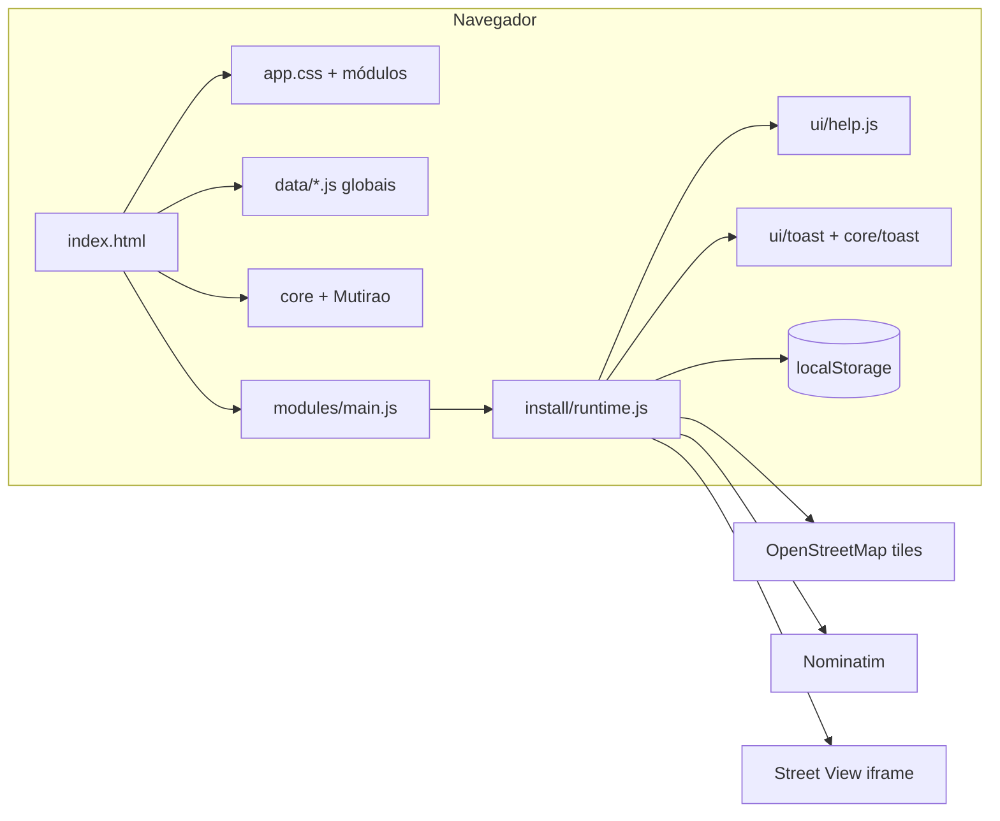
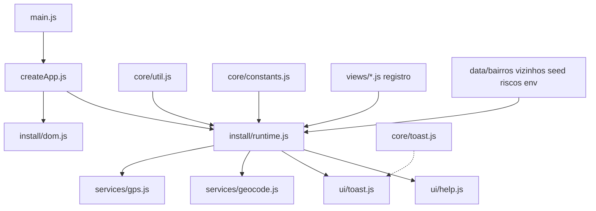
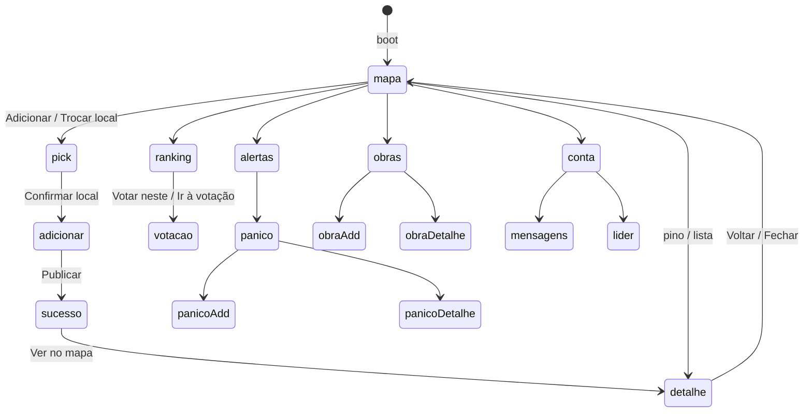
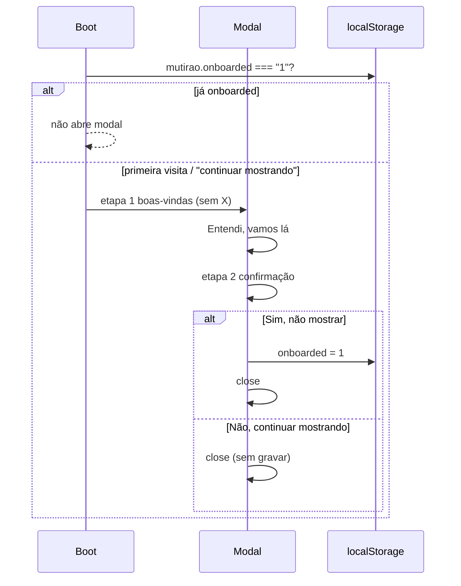
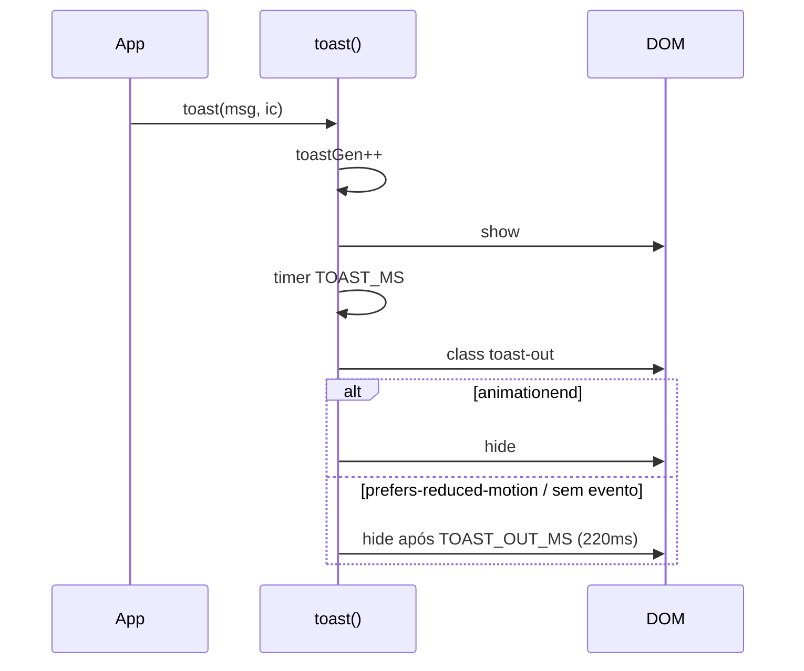
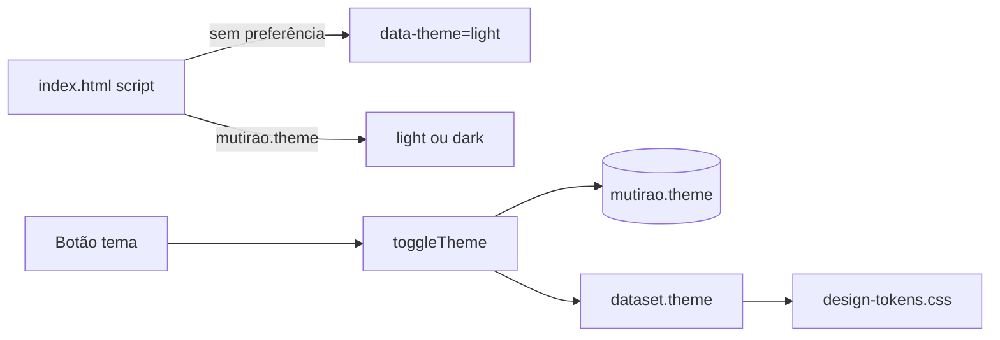
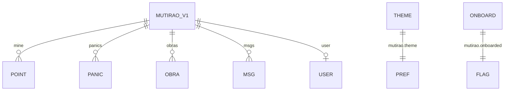

# Diagramas técnicos — Mutirão · Recife (1.11.2)

Cada caixa corresponde a arquivo, função ou chave de `localStorage` existente no repositório.

---

## 1. Contexto (C4 — sistema)



| Externo | Uso | API key |
|---------|-----|---------|
| Leaflet 1.9.4 + MarkerCluster | Mapa e clusters | Não |
| OSM tiles | Basemap | Não |
| Nominatim | Busca / reverse | Não (1 req/s; debounce) |
| Street View | Overlay iframe | Não |

---

## 2. Componentes (módulos JS)



---

## 3. Navegação de telas



Hash suportado: `#ranking`, `#votacao`, `#conta`, `#adicionar`, `#panico:ID`, `#obra:ID`, e demais em `HASH_VIEWS`.

---

## 4. Fluxo de onboarding (1.11.2)



---

## 5. Toast (auto-dismiss)



---

## 6. Temas



---

## 7. Cascata CSS (ordem crítica)

```
tokens → reset → shell → responsive-fix → map/* → components/* → animations → fase1 → mobile-lock (último)
```

`mobile-lock.css` (≤959.98px) impõe painel/mapa a 100% e **não** aplica `max-width` em tiles/SVG Leaflet.

---

## 8. Persistência



Detalhes de campos em [`DATA_AND_FLOWS.md`](DATA_AND_FLOWS.md).
